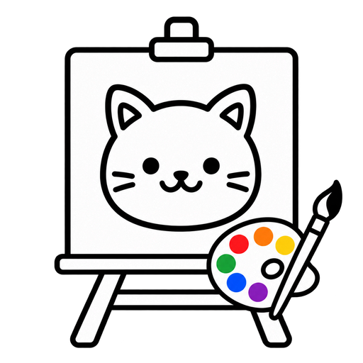
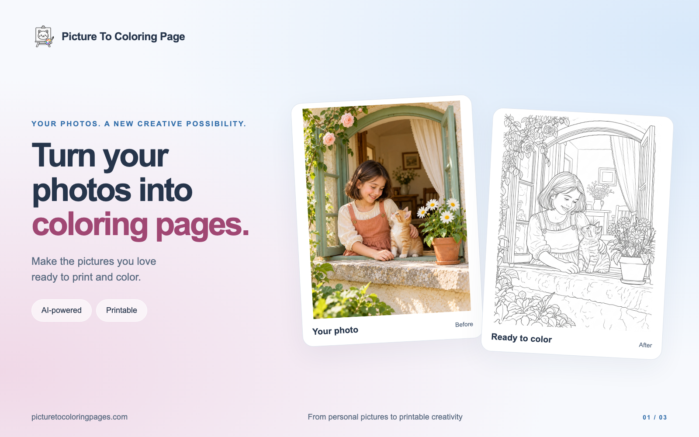
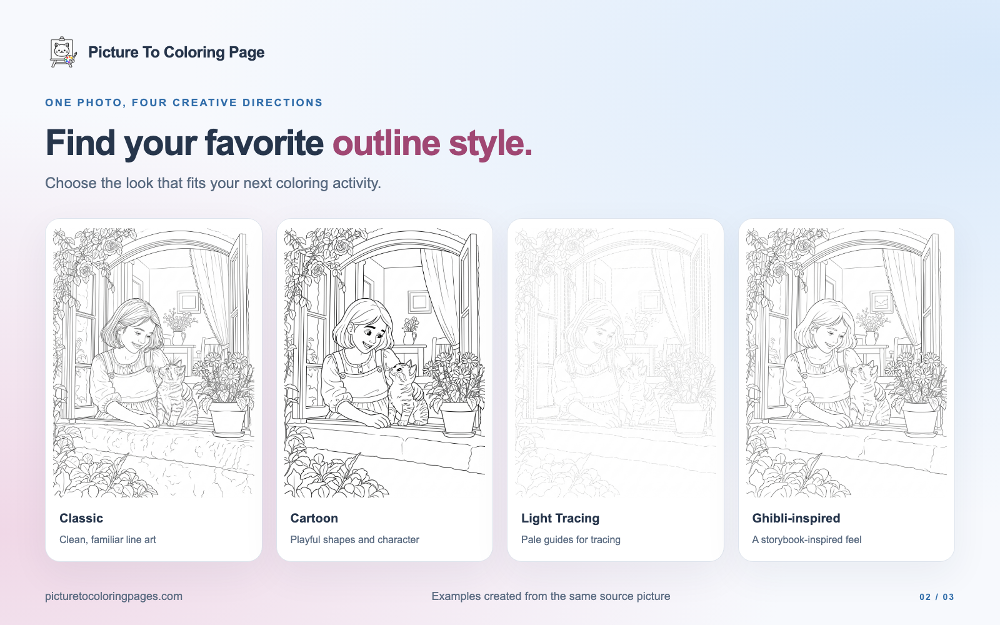
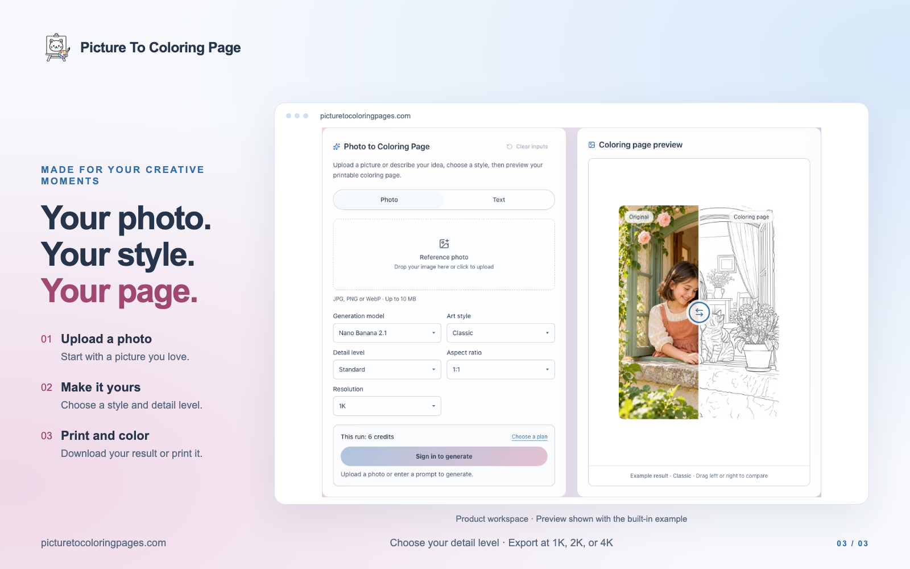

  

# Picture To Coloring Page：把照片变成可打印的涂色页

用 AI 将家人、宠物或喜爱场景的照片转换成专属涂色页，为亲子活动、课堂和个人创作增添熟悉的画面。

**[访问官方网站，开始制作涂色页](https://picturetocoloringpages.com)** · [中文网站](https://picturetocoloringpages.com/zh) · [问题与建议](https://github.com/977954608/picture-to-coloring-page-showcase/issues)

## 产品功能

- **照片转换**：上传 JPG、PNG 或 WebP 图片，生成个性化涂色页。
- **四种风格**：选择经典线稿、卡通、浅色描摹或吉卜力灵感风格。
- **独立细节调节**：选择简单、标准或丰富细节，调整涂色区域的数量与复杂程度。
- **多种分辨率**：支持选择 1K、2K 或 4K，生成前查看所需积分。
- **下载与打印**：下载没有额外水印的结果，或通过浏览器打印；可在打印对话框选择另存为 PDF。
- **注册试用**：新用户可获得试用积分，登录后体验生成。

## 同一张照片，不同的创作方向

风格决定轮廓的表现形式，细节等级决定涂色区域的疏密。可以根据照片内容、涂色者偏好和打印尺寸选择组合。

## 使用方法

1. [打开官网](https://picturetocoloringpages.com)，上传主体清晰的照片。
2. 选择风格、细节等级、画面比例与分辨率。
3. 登录并确认积分消耗，生成后检查预览。
4. 下载结果，或在浏览器打印预览中设置纸张、方向与缩放。

## 适合哪些场景

- **家庭与亲子**：用家人、宠物和旅行照片制作专属涂色活动。
- **课堂与兴趣活动**：从自然、静物和熟悉的物品中准备创作素材。
- **个人休闲**：为喜爱的照片尝试不同轮廓风格，享受涂色过程。

## 常见问题

### 这是开源项目吗？

本仓库用于公开介绍产品、展示效果并收集反馈，不包含网站应用源码。请直接通过官网使用产品。

### 可以免费试用吗？

新用户注册可获得试用积分。生成会消耗积分，不同设置的费用以提交前显示的信息为准。

### 可以直接下载 PDF 吗？

结果可下载为图片。需要 PDF 时，请使用浏览器打印对话框中的另存为 PDF 功能。

### 生成效果是否完全一致？

AI 结果会因输入图片、风格和设置而有所不同。建议使用主体清晰、光线充足的照片，并在打印前检查轮廓与细节。

## 反馈与联系

欢迎通过 [GitHub 问题反馈](https://github.com/977954608/picture-to-coloring-page-showcase/issues) 提交功能建议或可公开的问题说明。

涉及账号、支付或个人照片的问题，请发送至 [官方支持邮箱](mailto:support@picturetocoloringpages.com)，避免在公开反馈中包含个人信息。

## 相关链接

- [官方网站](https://picturetocoloringpages.com)
- [中文网站](https://picturetocoloringpages.com/zh)
- [隐私政策](https://picturetocoloringpages.com/privacy-policy)
- [服务条款](https://picturetocoloringpages.com/terms-of-service)
